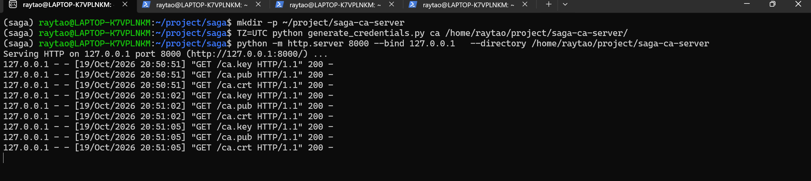
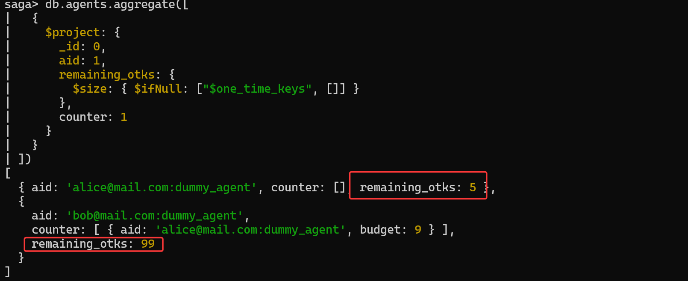
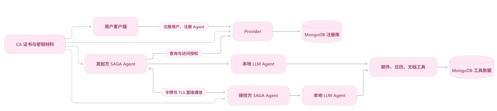

------

## 论文基本信息

题目：SAGA: A Security Architecture for Governing AI Agentic Systems [PDF](https://www.ndss-symposium.org/wp-content/uploads/2026-s869-paper.pdf)  

工作完成时间：初版提交（v1）：**2025年4月27日**；修订版提交（v2）：**2025年8月29日**

作者：Georgios Syros（博士生）, Anshuman Suri（博士后研究员）, Jacob Ginesin（参与时为本科生，现在卡内基梅隆大学攻读博士）, Cristina Nita-Rotaru （NDS2 实验室联合主任）, Alina Oprea（NDS2 实验室联合主任）

机构：Network and Distributed Systems Security [[nds2](http://nds2.ccs.neu.edu/)]，Northeastern University

开源代码：https://github.com/gsiros/saga

NDSS会议视频：https://www.youtube.com/watch?v=NZvfPHAciyE

NDSS会议PPT：https://www.ndss-symposium.org/wp-content/uploads/s0869-syros-slides.pdf

------

## 代码复现 SAGA

### 一、环境配置

基本环境：一台 Windows11 的个人笔记本，配置了 WSL2 环境，使用 Miniconda 管理 Python 环境，并用 Pycharm运行代码。在Windows 下安装了 Docker Desktop。

#### 1 下载源码

```bash
mkdir -p ~/project
cd ~/project
git clone https://github.com/gsiros/saga.git
cd saga
ls
```

#### 2 配置 Python 环境

使用 conda 创建 python = 3.10.16：

```bash
conda create -n saga python=3.10.16 pip -y
conda activate saga
```

**根据项目`requirements.txt` 配置需要的库环境：**

```bash
python -m pip install simple-parsing

python -m pip install \
  -r <(sed '\|github.com/lebrice/SimpleParsing|d' requirements.txt) \
  "smolagents==1.12.0" "PyYAML==6.0.2"

python -m pip install -e .
```

测试 python 环境是否可以：

```bash
python -c "from simple_parsing.helpers import Serializable; import saga.config; print('依赖导入成功')"
```

#### 3 配置数据库

使用 Docker 为 SAGA 项目创建一个独立的 MongoDB 数据库，用于持久化存储项目运行过程中产生的数据。主要用于保存 Provider 注册信息（服务提供者的配置、注册记录等）。邮件数据（工具读取或处理的邮件信息）。日历数据（日程、事件等）。文档数据（工具管理的文档信息）。

在 wsl 中检查 docker 版本，正常情况下会同时显示 `Client` 和 `Server` 信息：

```bash
docker version
```

**创建 SAGA 专用 Mongo DB。**

参数解析：容器命名为 `saga-mongo`；Docker 重启后自动启动，除非手动停止；将MongoDB端口映射到宿主机本地；使用 Docker 数据卷持久化数据库数据（即使删除 MongoDB 容器，数据卷通常仍会保留，避免数据库数据丢失）；使用MongoDB 7.0 官方镜像：

```bash
docker run -d \
  --name saga-mongo \
  --restart unless-stopped \
  -p 127.0.0.1:27017:27017 \
  -v saga-mongo-data:/data/db \
  mongo:7.0
```

检查数据库：

```bash
docker ps --filter name=saga-mongo
docker exec saga-mongo mongosh --quiet --eval 'db.adminCommand({ping: 1})'

# 正常输出
{ "ok": 1 }
```

**以后已有容器时，使用以下命令进行启动或停止：**

```bash
# 启动：
docker start saga-mongo
# 停止：
docker stop saga-mongo
```

从 python 检查连接：

```bash
python -c "from pymongo import MongoClient; c=MongoClient('mongodb://localhost:27017/', serverSelectionTimeoutMS=5000); print(c.admin.command('ping'))"

# {'ok': 1.0}
```

再确认项目读到了本地配置：（`config_local.yaml`用于本地单机复现，`config.yaml`则是为实际配置）

```bash
# 备份原始配置：
cd ~/project/saga
cp config.yaml config.yaml.bak
#使用官方本地配置覆盖：
cp config_local.yaml config.yaml
# 验证配置：
python -c "import saga.config as c; print(c.CA_CONFIG['endpoint']); print(c.PROVIDER_CONFIG['endpoint']); print(c.MONGO_URI_FOR_TOOLS)"
# 输出
CA: http://127.0.0.1:8000
Provider: https://127.0.0.1:5000
Tools DB: mongodb://127.0.0.1:27017/saga_tools
```

------

### 二、试运行

确保各方环境准备完毕。进入项目目录，激活 `saga` conda 环境，确认 `config.yaml` 已采用 `config_local.yaml` 的本地配置；启动 Docker：`docker start saga-mongo`，确认 WSL 中的 Python 能连接 MongoDB。

然后启动四个终端 `A`、`B`、`C`、`D`，`E`：**A 负责 CA 文件服务**，端口 `8000`；**B 负责 Provider**，端口 `5000`；**C 负责注册**；**D 负责 Bob**，端口 `7001`；**E 负责 Alice**，发起通信。

#### 1 终端 A：生成 CA 材料并启动文件服务

**保持这个终端运行。** 首次运行生成证书即可，后续启动一般不需要重新生成。 在项目的实际部署过程中，CA 配置指定了其文件服务端点 http://129.10.186.246:8000，并设置了证书主体信息：国家 US、州 MA、城市 Boston、组织 ca。

```bash
wsl
conda activate saga
cd ~/project/saga

# 读取 config.yaml 中的 CA 配置，在 saga/ca/ 下生成：ca.key(CA私钥)	ca.pub(CA公钥)	ca.crt(CA自签名证书)
mkdir -p ~/project/saga-ca-server
TZ=UTC python generate_credentials.py ca /home/raytao/project/saga-ca-server/

# 把当前目录通过 HTTP 提供出来，地址是 http://127.0.0.1:8000，可以访问这个下载 CA证书
python -m http.server 8000 --bind 127.0.0.1 \
  --directory /home/raytao/project/saga-ca-server

# 输出
Serving HTTP on 127.0.0.1 port 8000 (http://127.0.0.1:8000/) ...
```



------

#### 2 终端 B：启动 Provider

**保持这个终端运行。** 注意必须在 `saga/provider` 目录启动，因为程序用当前目录保存 Provider 证书。

首先 Provider 从 CA 端点 `http://127.0.0.1:8000` 拉取 `ca.key`、`ca.pub`、`ca.crt` 三个文件。Provider 是一个 Flask 应用，监听 `0.0.0.0:5000`（所有网卡），所以本机 `127.0.0.1:5000`  都能访问。

```bash
wsl
conda activate saga
cd ~/project/saga/saga/provider

# 一定要加 TZ=UTC，确保证书时间
TZ=UTC python provider.py

# 输出
Running on https://127.0.0.1:5000
```


------

#### 3 终端 C：注册 Alice、Bob 及其 Agent

若已经注册过，再次注册会失败。可以运行以下重置：

```python
python - <<'PY'
from pymongo import MongoClient

with MongoClient("mongodb://localhost:27017") as client:
    db = client["saga"]
    agents = db.agents.delete_many({
        "aid": {"$regex": r"^(alice|bob)@mail\.com:"}
    })
    users = db.users.delete_many({
        "uid": {"$in": ["alice@mail.com", "bob@mail.com"]}
    })
    print(f"删除用户 {users.deleted_count} 个，Agent {agents.deleted_count} 个")
PY
```

```bash
wsl
conda activate saga
cd ~/project/saga/saga/user

# 注册
TZ=UTC python user.py --uconfig ../../user_configs/alice.yaml --register --register-agents
TZ=UTC python user.py --uconfig ../../user_configs/bob.yaml --register --register-agents

# 输出
saga/user/alice@mail.com:dummy_agent/agent.json
saga/user/bob@mail.com:dummy_agent/agent.json
```


------

#### 4  终端 D：让 Bob 等待连接

注册完成后，在同一个终端执行，Bob 将监听 `7001` 端口。**保持运行**：

```bash
cd ~/project/saga/experiments
python hello_world.py listen ../user_configs/bob.yaml
```


------

#### 5 终端 E：让 Alice 发起通信

这条命令表示：**Alice 发起请求，联系 Bob**。成功时，两侧会出现连接、令牌和消息交互日志。DummyAgent 会随机回复简单句子，直到结束；不一定原样回复 `Hello world!`。

```bash
conda activate saga
cd ~/project/saga/experiments

python hello_world.py query ../user_configs/alice.yaml ../user_configs/bob.yaml
```


------

#### 6 数据库操作

项目的注册信息保存在 MongoDB 的 **`saga` 数据库**中，`users用户注册表`,`agents 智能体注册表`。

```bash
# 连接数据库
docker ps
docker exec -it saga-mongo mongosh saga
# 查看注册数量和用户列表
show collections
db.users.countDocuments({})	# 2
db.agents.countDocuments({}) # 2
db.users.find({}, { _id: 0, uid: 1 }) # [ { uid: 'alice@mail.com' }, { uid: 'bob@mail.com' } ]
# 查看所有 Agent 的注册情况
db.agents.find(
  {},
  {
    _id: 0,
    aid: 1,
    device: 1,
    IP: 1,
    port: 1,
    contact_rulebook: 1
  }
).pretty()
# 查看所有 Agent 的剩余一次性密钥数量：
db.agents.aggregate([
  {
    $project: {
      _id: 0,
      aid: 1,
      remaining_otks: {
        $size: { $ifNull: ["$one_time_keys", []] }
      },
      counter: 1
    }
  }
])
```




------

### 三、项目代码详解

**用户向 Provider 注册自己和 Agent；发起方通过 Provider 获取接收方信息及一次性密钥；两个 Agent 建立令牌与安全连接，随后直接通信。** Provider 不转发后续所有对话。以下是项目图：




#### 1 项目目录略看

```markdown
saga/
├── setup.py                         # Python 包安装配置
├── requirements.txt                 # Python 依赖清单
├── saga.yml                         # Conda 环境配置
├── config.yaml                      # 实际读取的全局配置
├── config_local.yaml                # 本地部署配置样例
├── generate_credentials.py          # 生成证书及密钥材料
│
├── saga/                            # SAGA 协议与通信框架
│   ├── __init__.py
│   ├── config.py                    # 配置加载与配置对象
│   ├── agent.py                     # Agent 通信与会话管理
│   ├── local_agent.py               # 任务执行接口与模拟 Agent
│   ├── logger.py                    # 日志辅助类
│   ├── ca/
│   │   └── CA.py                    # 证书材料管理与证书操作
│   ├── provider/
│   │   └── provider.py              # 注册与访问授权服务
│   ├── user/
│   │   ├── __init__.py
│   │   └── user.py                  # 用户命令行客户端
│   └── common/
│       ├── contact_policy.py        # 联系规则检查与匹配
│       ├── crypto.py                # 密钥、签名、证书和令牌工具
│       ├── logger.py                # 主要使用的日志工具
│       └── overhead.py              # 运行耗时记录
│
├── agent_backend/                   # LLM 任务执行层
│   ├── __init__.py
│   ├── config.py                    # LLM Agent 配置对象
│   ├── base.py                      # 模型与工具的统一封装
│   ├── custom_prompts/
│   │   ├── CodeAgent.yaml           # 默认提示词模板
│   │   └── finalized/
│   │       └── CodeAgent_calendar.yaml
│   └── tools/
│       ├── __init__.py
│       ├── base.py                  # 业务工具公共接口
│       ├── email.py                 # 邮件工具
│       ├── calendar.py              # 日历工具
│       └── documents.py             # 文档工具
│
├── experiments/                     # 示例与任务入口
│   ├── hello_world.py               # 无 LLM 的通信示例
│   ├── schedule_meeting.py          # 协商会议任务
│   ├── expense_report.py            # 汇总报销任务
│   ├── create_blogpost.py           # 协作写作任务
│   ├── seed_tool_data.py            # 导入业务示例数据
│   ├── test.py                      # 工具与本地 Agent 调试脚本
│   └── data/
│       ├── emma/
│       │   ├── email.jsonl
│       │   ├── calendar.jsonl
│       │   └── documents.jsonl
│       └── raj/
│           ├── email.jsonl
│           ├── calendar.jsonl
│           └── documents.jsonl
│
└── user_configs/                    # 用户和 Agent 配置
    ├── alice.yaml
    ├── bob.yaml
    ├── candice.yaml
    ├── emma.yaml
    ├── mallory.yaml
    └── raj.yaml
```

------

#### 2 配置文件

**1）**`config.yaml` 与 `config_local.yaml`:

`config.yaml` 是项目运行时实际读取的全局配置文件，用于指定 CA、Provider 的服务地址、工具数据库地址以及用户和 Agent 的默认证书信息；`config_local.yaml` 则是供**本机部署参考的配置样例**，将相关服务地址设为 `127.0.0.1`。程序不会自动切换到 `config_local.yaml`，因此本地运行时，需要将其内容复制到 `config.yaml`，或参照它修改对应配置。


**2）**`alice.yaml`、`bob.yaml`、`candice.yaml`、`emma.yaml`、`mallory.yaml`、`raj.yaml`

这些文件是**不同示例用户的配置文件**，用于描述用户姓名、邮箱、登录密码及其拥有的 Agent，并为每个 Agent 指定名称、运行地址、端口、**联系规则、一次性密钥数量**，以及**模型和工具配置**。其中，`alice.yaml`、`bob.yaml` 和 `candice.yaml` 主要配置不使用 LLM 的模拟 Agent，**供基础通信或协议测试使用**；`emma.yaml` 和 `raj.yaml` 配置日历、邮件和写作 Agent，用于三类协作任务；`mallory.yaml` 则提供**攻击**实验中的用户与 Agent 配置。


**3）**`generate_credentials.py`

`generate_credentials.py` 用于**生成 CA 或 Provider 的密钥对和自签名证书，并保存到指定目录**。运行时，通过命令行参数 `ca` 或 `provider` 选择 `config.yaml` 中对应的证书配置，再由 `main(config, file_path)` 完成生成和保存，输出 `.key` 私钥文件、`.pub` 公钥文件和 `.crt` 证书文件。

------

#### 3 saga

**1）**`config.py`

`saga/config.py` 负责加载全局配置，并定义用户和 Agent 的配置结构。

模块导入时会调用 `populate_config()`，读取根目录的 `config.yaml`，检查必要配置并保存 CA、Provider、工具数据库及默认证书信息，同时定义相关工作目录和令牌通信配额。

-  `EndPointConfig` 描述 Agent 的 IP、端口和设备名，并检查端口范围，包括 **ip、port、device_name**；
- `AgentConfig` 描述 Agent 的基本信息、联系规则和模型配置，包括 **name**、description、**local_agent_config**: LocalAgentConfig、**endpoint**: EndPointConfig、**contact_rulebook**: Optional[List[str]]、**num_one_time_keys**: Optional[int] ;
- `UserConfig` 描述用户及其 Agent 列表，包括 **name**、**email**、**agents:** List[AgentConfig]；

`get_index_of_agent()` 则根据名称查找指定 Agent 在配置列表中的位置。


**2）**`agent.py`**

`saga/agent.py` 是 **Agent 通信与会话管理的核心模块**，负责加载身份材料、向 Provider 获取目标 Agent 的访问资料、管理访问令牌，以及建立连接和收发消息。文件中的 `get_agent_material()` 读取 Agent 工作目录下的 `agent.json`，`serialize()` 和 `deserialize()` 负责传输数据的格式转换；

核心类 `Agent` 通过 `connect()` 主动连接其他 Agent，通过 `listen()` 等待连接，通过 `handle_i_agent_connection()` 处理接入请求，再由 `initiate_conversation()` 和 `receive_conversation()` 管理双方的多轮对话。对话中的具体任务交给传入的 `LocalAgent` 执行，未提供时使用 `DummyAgent`。


**3）**`local_agent.py`

`saga/local_agent.py` 定义任务执行对象的统一接口，使 SAGA 通信框架能够接入不同的 Agent 实现。其中，抽象类 `LocalAgent` 通过 `run()` 规定一轮任务的执行入口，接收查询内容、发起方或接收方角色以及已有会话对象，并返回执行对象和回复；`DummyAgent` 则提供无需 LLM 的模拟实现，通过预设回复和任务结束标记支持基础通信测试。该文件负责约定任务执行方式，具体模型和工具由其他模块接入。


**4）**`logger.py`

`logger.py` 提供统一的控制台日志输出功能，便于观察程序运行状态。核心类 `Logger` 中，`hash_tag()` 根据日志标签选择显示颜色，`log()` 输出带时间戳和模块标签的普通日志，`warn()` 和 `error()` 分别输出警告与错误信息。项目中有 `saga/logger.py` 和 `saga/common/logger.py` 两份功能相近的文件，主要业务模块使用后者。


**5）**`ca/`、`provider/`、` user/`

`ca/` 负责证书材料管理，其中 `CA.py` 提供材料下载、加载、证书签发和检查功能；`provider/` 负责集中式注册与访问授权，其中 `provider.py` 启动 HTTPS 服务，处理用户注册、登录、Agent 注册，以及根据联系规则提供目标 Agent 信息和一次性密钥；`user/` 负责用户侧操作，其中 `user.py` 提供交互式和配置文件两种使用方式，完成用户注册、登录、Agent 注册，并在本地保存用户密钥、证书及 Agent 的 `agent.json` 等运行材料。


**6）**`common/`

`saga/common/` 存放注册与通信模块共用的辅助功能：`contact_policy.py` 负责检查 Agent 标识和联系规则，并匹配访问预算；`crypto.py` 提供密钥生成与保存、消息签名与检查、证书处理以及令牌加解密功能；`logger.py` 统一输出带时间和模块标签的日志；`overhead.py` 通过 `Monitor` 类记录各项操作的开始、结束和累计耗时，为运行状态观察和性能统计提供支持。

------

#### 4 agent_backend

**1）**`config.py `

`agent_backend/config.py` 定义任务执行 Agent 的配置结构，核心类 `LocalAgentConfig` 用于描述模型名称、模型接入方式、API 地址、可用工具、额外任务说明、代码执行时允许导入的模块，以及底层 Agent 类型。其 `__post_init__()` 方法在配置对象创建后进行必要检查，例如使用 `OpenAIServerModel` 时必须提供 `api_base`。该文件只描述和检查配置，实际模型初始化与任务执行由 `agent_backend/base.py` 完成。


**2）**`base.py`

`agent_backend/base.py` 负责将 LLM、提示词和业务工具组合为可供 SAGA 调用的任务执行对象。核心类 `AgentWrapper` 提供模型初始化、提示词加载和工具收集功能，并通过 `run()` 执行一轮任务、保留当前会话状态并返回回复；其工具组涵盖邮件收发、日历查询与安排、文档检索与创建、报销提交以及用户信息查询。子类 `CodeAgentWrapper` 负责创建具体的 smolagents `CodeAgent`，而工厂函数 `get_agent()` 根据配置选择并返回相应封装，目前实际支持 `CodeAgent`。


**3）**`custom_prompts/`

`agent_backend/custom_prompts/` 存放 LLM Agent 使用的提示词模板，用于规定任务执行方式、发起方与接收方的角色行为、工具使用要求和任务结束标记。其中，`CodeAgent.yaml` 是 `CodeAgentWrapper` 默认加载的模板，可填入当前日期、任务内容和 Agent 专属说明；`finalized/CodeAgent_calendar.yaml` 则保存面向日历任务的另一份模板，当前默认流程不会自动加载它。这些文件参与模型行为配置，不是普通说明文档。


**4）**`tools/`

`agent_backend/tools/` 提供 LLM Agent 执行任务所需的业务工具，数据由 MongoDB 保存。其中，`base.py` 定义公共基类 `BaseTool`，提供数据库集合访问、数据清理和联系人信息提取等功能；`email.py` 提供邮件导入、收发和检索功能；`calendar.py` 提供日程导入、日程查询、空闲时间查询及会议创建功能；`documents.py` 提供文档导入、检索和创建功能。上述工具由 `agent_backend/base.py` 封装后提供给模型调用，`__init__.py` 则用于标识 Python 包。

------

#### 5 experiments

**1）**`hello_world.py`

`experiments/hello_world.py` 是不依赖 LLM 的双 Agent 通信示例，用于演示 SAGA 的基本连接与对话流程。其 `main()` 函数读取用户配置中的 `dummy_agent`，加载对应的 `agent.json` 身份材料并创建 `Agent` 实例：在 `listen` 模式下等待其他 Agent 连接，在 `query` 模式下读取目标用户配置，主动连接对方并发送 `"Hello world!"`。由于没有传入具体任务执行对象，对话回复由 `DummyAgent` 生成。


**2）**`schedule_meeting.py`、`expense_report.py `、`create_blogpost.py`

`experiments/` 中的这三个文件分别是论文三类协作任务的运行入口：`schedule_meeting.py` 让两个日历 Agent 查询空闲时间、协商并创建会议，随后检查双方日程是否一致、是否冲突及会议时长是否符合要求；`expense_report.py` 让两个邮件 Agent 收集费用信息、汇总金额并向 HR 提交报销邮件，随后检查邮件参与者和金额；`create_blogpost.py` 让两个写作 Agent 参考已有文档协作撰写文章，随后检查是否保存了符合预期标题的文档。三个文件均通过 `main()` 加载配置并创建 Agent，支持 `listen` 接收任务和 `query` 主动发起任务两种模式。


**3）**`seed_tool_data.py`

`experiments/seed_tool_data.py` 用于初始化协作任务所需的邮件、日历和文档数据。其中，`read_jsonl_data()` 将 JSONL 文件读取为记录列表；`main()` 先删除工具数据库 `saga_tools`，再遍历用户配置，根据各用户启用的工具，从 `experiments/data/` 读取对应数据，并调用工具的 `seed_data()` 方法导入。因此，该脚本用于重置实验数据，每次运行都会清除已有的工具数据。


**4）**`test.py `

`experiments/test.py` 是用于手动调试本地 Agent 和业务工具的脚本。其 `main()` 函数读取用户配置，选取第一个 Agent，通过 `get_agent()` 创建任务执行对象，再调用邮件、日历等工具并打印结果，以检查工具是否能够正常使用。它属于开发调试入口，不是标准单元测试，也不是三类双 Agent 协作任务的运行入口。


**5）**`data/`

`experiments/data/` 存放协作任务使用的初始业务数据，按用户分为 `emma/` 和 `raj/` 两个子目录，每个目录均包含 `email.jsonl`、`calendar.jsonl` 和 `documents.jsonl`，分别保存示例邮件、日程及文章或文档内容。这些文件采用每行一条 JSON 记录的格式，由 `seed_tool_data.py` 读取并导入 MongoDB，为会议安排、费用报销和协作写作任务提供数据，不包含可执行代码。

------

### 四、安全验证复现

